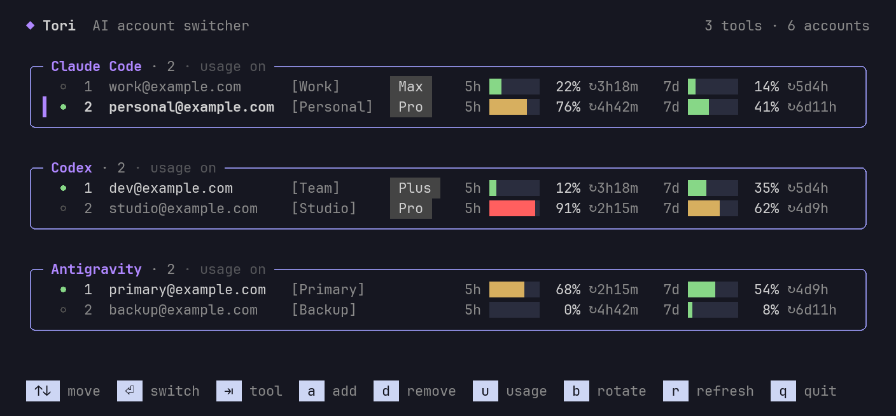

<p align="center"></p>

Tori is a fast terminal account switcher for **Claude Code**, **Codex** and **Antigravity**, with optional usage meters for every saved account (off by default, see [Usage meters](#usage-meters)).



## Install

### Quick install (Linux & macOS)

```bash
curl -fsSL https://raw.githubusercontent.com/Anurag-Raut/tori/main/install.sh | sh
```

This installs the `tori` binary to `${PREFIX:-$HOME/.local/bin}`. Make sure `~/.local/bin` is on your `PATH`.

### Go install

```bash
go install github.com/Anurag-Raut/tori@latest
```

## Setup

Save each account once; Tori then switches between them.

### Claude Code

```bash
claude            # /login as your first account
tori c add Work
claude            # /login as the next account
tori c add Personal
```

> **macOS note:** On macOS, Claude Code stores its login in the Keychain rather than `~/.claude/.credentials.json`, which Tori does not support yet.

### Codex

```bash
codex login       # first account
tori x add Work
codex login       # next account (after logging out)
tori x add Personal
```

Codex reads its login at startup, so **restart codex after switching**.

### Antigravity

```bash
tori g add primary      # while signed in to Antigravity (in T3 Code)
tori g add backup       # after signing in with the next account
```

The alias is optional; the Google email is read the first time usage loads (with meters on). Restart any running Antigravity session after switching.

## Picker keys & mouse

Run `tori` with no arguments to open the interactive Bubble Tea picker (supports keyboard and mouse).

| Key / Mouse | Action |
|---|---|
| `↑` `↓` / `j` `k` / scroll wheel | Move selection |
| Hover / Click / Double-click | Hover rows, footer pills, and modal buttons; click buttons or footer shortcuts; double-click row to switch |
| `Enter` | Switch to the selected account (or add on an empty tool) |
| `Tab` | Jump to the next tool |
| `a` | Guided add for all 3 tools (saves a new signed-in account right away, or guides you to log out & sign in to the next account and re-check) |
| `b` | Rotate every tool with 2 or more saved accounts |
| `d` / `Delete` | Guided remove (for active slots, offers one-key switch-and-remove or clear local login; renumbers remaining slots) |
| `u` | Turn usage meters on or off for the selected tool (shows a disclaimer modal before turning on) |
| `r` | Force-refresh usage (tools with meters on) |
| `q` / `Esc` / `Ctrl+C` | Quit (or close active modal first on `Esc`) |

## Usage meters

Meters are optional and **off by default**. While a tool's meters are off, Tori makes zero network requests for it. Turn them on per tool with `u` in the picker or `tori usage on c` (also `x`, `g`, `all`); both show a disclaimer first, and the choice is saved in `~/.tori/config.json`. Switching, adding and removing accounts never need the network.

Meters are green below 60%, yellow from 60%, red from 85%, with a reset countdown when known. Cached readings (180s TTL) are shown dimmed with their age when stale.

## CLI reference

```bash
tori                   # interactive picker
tori list              # all accounts; meters if on (--no-usage hides, --refresh re-reads, --json)
tori usage             # show meters on/off per tool
tori usage on c        # c|x|g|all; shows the disclaimer, asks y/N (--yes skips)
tori usage off all
tori status            # current account per tool
tori switch            # rotate every tool to its next account
tori --version         # print version
```

Per-tool prefixes: `c` / `claude` (Claude Code), `x` / `codex` (Codex), `g` / `a` / `agy` / `antigravity` (Antigravity). Bare `tori c` is `tori c list`.

```bash
tori c switch 2        # by slot number, email or alias
tori x alias 1 Work    # --unset to clear
tori g remove 2        # asks y/N; -y/--yes skips (remaining slots are renumbered)
tori c list --json     # machine-readable
```

Each tool takes `list`, `status`, `add [alias]`, `switch [num|email|alias]`, `remove <ref>`, `alias <ref> <name>` and `help`.

## Works with the official tools

Tori sits beside Claude Code, Codex and Antigravity, not between them and the provider. There is no proxy: your tools keep talking to their provider directly, and Tori only changes which of your own saved logins is in place when you ask it to. It never shares accounts, routes requests or runs in the background.

## Terms of use

Usage meters are off by default. When on, Tori reads quota directly from each provider using your saved logins (and may refresh expired tokens). Nothing is sent anywhere else, and you can turn meters off any time.

- **Antigravity**: Google's terms prohibit third-party tools using Antigravity sign-in and may lead to account suspension. Turn Antigravity meters on only if you accept that risk.

## Privacy

- Saved logins live only on your machine, under `~/.tori/` (`claude`, `codex`, `antigravity`), written atomically with `0600` permissions. Never share that folder.
- With meters off (the default) Tori makes no network calls. With them on, the only calls go to each provider's own usage and token endpoints (Anthropic, OpenAI, Google), to read quotas and to refresh an inactive account's expired token.
- Accounts saved by earlier versions (`~/.claudeswap`, `~/.codexswap`, `~/.aswap`) are moved into `~/.tori/` automatically on first run.
- Claude Code on macOS stores its login in the Keychain, which is currently unsupported.

## License

MIT, see [LICENSE](LICENSE).
